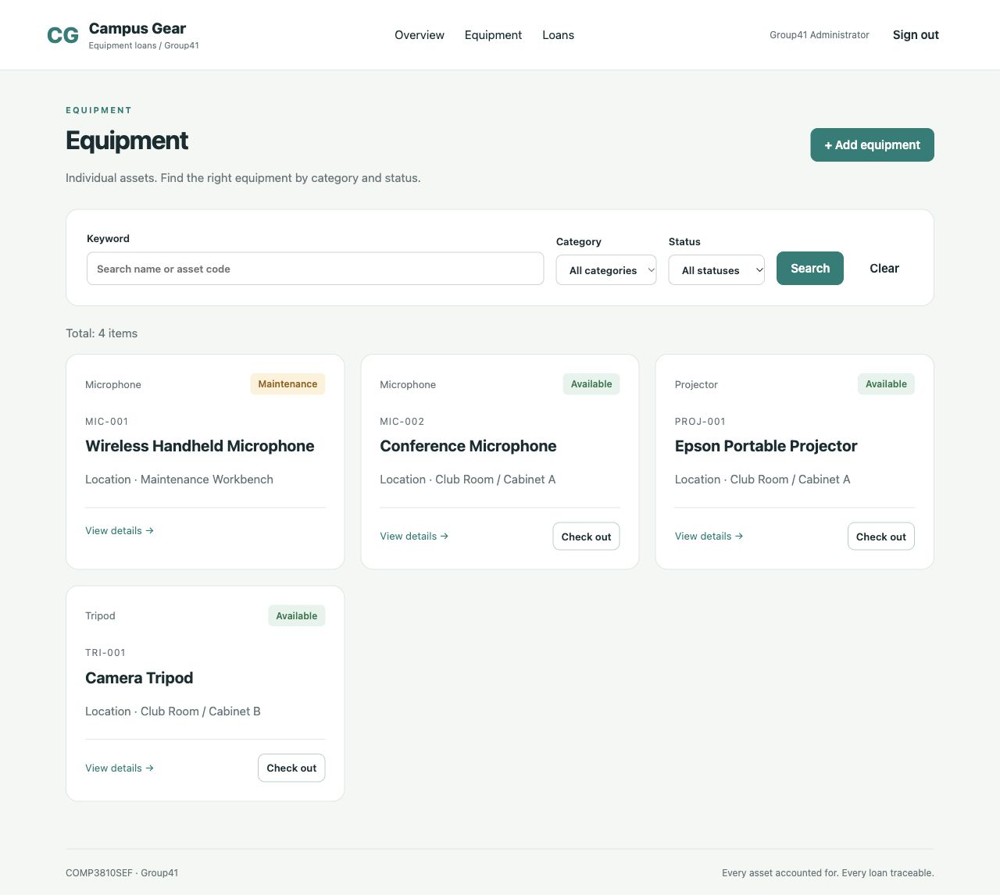

# Campus Gear — Group41

An English-language campus equipment loan manager built with **Express.js, Mongoose, MongoDB and EJS** for COMP 3810SEF (Autumn 2026).



## 1. Project info

Each document represents **one physical asset**, identified by a unique asset code. Staff can maintain projectors, microphones and tripods, lend available assets, record returns, and search equipment and loan history.

- Equipment states: `available`, `borrowed`, `maintenance`.
- A physical asset may have **at most one active loan**.
- Borrowing and returning update the asset and loan together in MongoDB transactions.
- Maintenance blocks borrowing. Equipment with loan history is retained; deletion is demonstrated with a separate unused asset.
- Authenticated web CRUD, logout, combined search filters, REST CRUD, server validation and responsive pages are included.
- No quantity inventory, booking queue, payment system or student self-service account is required.

**Implementation provenance:** This repository starts with an Agent-generated reference implementation. It must not be represented as six students' completed original work. The course prohibits purely AI-generated / Agent-completed submissions. Each member must independently understand, review, adapt and test their assigned work, record actual contributions, and comply with the instructor's rules before submission. See [team workflow](docs/TEAM_WORKFLOW.md) and [implementation notes](docs/IMPLEMENTATION_NOTES.md).

## 2. Group info

Group number: **41**. Names, SIDs and the final assignment must be completed by the group. The table describes proposed ownership, not work already performed by those students.

| Role | Student name / SID | Proposed ownership                                         | Main files                                                        |
| ---- | ------------------ | ---------------------------------------------------------- | ----------------------------------------------------------------- |
| LIU Jinwei   | To be completed    | Integration, configuration and authentication              | `server.js`, `app.js`, `routes/auth.js`, `middleware/auth.js`     |
| HE Ziqian    | To be completed    | Data model, indexes, seed and equipment rules              | `models/index.js`, `config/db.js`, `services/equipmentService.js` |
| ZHU Hengxi   | To be completed    | Equipment web CRUD and filters                             | `routes/equipment.js`, `views/equipment/`                         |
| LEI Haodong  | To be completed    | Loan, return and maintenance verification                  | `services/loanService.js`, `routes/loans.js`, `views/loans/`      |
| SHEN Xin     | To be completed    | REST services and curl demonstration                       | `routes/api.js`, `scripts/demo-api.sh`, `docs/API.md`             |
| LIU Jiaxu    | To be completed    | Interface, integration tests and presentation coordination | `public/`, `tests/`, `docs/DEMO.md`                               |

All six members should be able to explain the entire request → route → service → model → database → response flow. All members must contribute; presenting alone does not substitute for implementation work.

## 3. Project file intro

| File or folder                      | Purpose                                                                              |
| ----------------------------------- | ------------------------------------------------------------------------------------ |
| `server.js`                         | Loads environment, connects MongoDB, creates persistent sessions and starts Express. |
| `package.json`, `package-lock.json` | Runtime/development dependencies and reproducible npm commands.                      |
| `app.js`                            | Express middleware, EJS setup, dashboard, routes and error responses.                |
| `config/db.js`                      | Verifies transaction-capable MongoDB and initializes model indexes.                  |
| `models/index.js`                   | User, Equipment and Loan schemas; unique asset and active-loan indexes.              |
| `services/`                         | Shared validation and business operations used by web and REST routes.               |
| `routes/`                           | Authentication, equipment forms, loan forms and JSON APIs.                           |
| `middleware/`, `lib/`               | Session authorization, CSRF, input validation and consistent errors.                 |
| `views/`                            | EJS login, dashboard, CRUD, loan/history and error pages.                            |
| `public/`                           | Local CSS and small JavaScript helpers; no external CDN required.                    |
| `scripts/`                          | Seed, temporary demo server, syntax check and curl demonstration.                    |
| `tests/`                            | Integration tests with a real temporary MongoDB replica set.                         |
| `docs/`                             | API, architecture, deployment, group workflow and demo instructions.                 |
| `.github/`                          | Ubuntu CI, issue template and pull-request checklist.                                |
| `Dockerfile`, `compose.yaml`        | Optional persistent local container setup.                                           |

## 4. Operation guides

### Quick start: temporary local demonstration

Prerequisites: Node.js **22**, npm, and Internet access on the first run to download dependencies and a MongoDB 7.0.24 binary. On Ubuntu, use a supported 22.04/24.04 environment with MongoDB runtime libraries (including `libcurl4` and OpenSSL 3); see [deployment](docs/DEPLOYMENT.md).

```bash
git clone https://github.com/lauzw22-mt124/campus-equipment-loan-manager.git
cd campus-equipment-loan-manager
npm ci
npm run demo
```

Open **http://127.0.0.1:8099**. Local demo credentials:

| Username  | Password             |
| --------- | -------------------- |
| `admin41` | `Group41-Demo-2026!` |

`npm run demo` starts a real temporary MongoDB replica set automatically. It binds only to loopback, uses memory sessions and **clears demo data when stopped**. It ignores the persistent database in `.env`. Use it for practice and tests, not long-term shared data. The first launch can take longer while downloading MongoDB. Start it before the live presentation.

### Persistent installation

Use a MongoDB replica set, MongoDB Atlas, or the Docker Compose setup. A standalone `mongod` cannot run this project's transactions.

```bash
cp .env.example .env
node -e "console.log(require('node:crypto').randomBytes(32).toString('hex'))"
# Edit .env: MONGODB_URI, generated SESSION_SECRET and your own ADMIN_PASSWORD.
npm run seed
npm start
```

The account is `ADMIN_USERNAME` / `ADMIN_PASSWORD` from your `.env`; there is no public registration screen. Seed inserts missing data and does not reset an existing account password or asset state. Do not commit `.env`. Follow the detailed [deployment guide](docs/DEPLOYMENT.md) for Docker, Ubuntu and HTTPS hosting.

### Login / logout

1. Visit `/login`, enter a valid administrator username and password, and select **Sign in**.
2. The dashboard shows equipment totals and recent loans. Unauthenticated attempts to open CRUD pages return to login.
3. Select **Sign out** from any authenticated page to destroy the session.

### Equipment CRUD and searching

1. Open **Equipment** → **Add equipment**. Enter a unique asset code (for example `DEMO-101`), name, category, location and optional notes. Save the record. It begins as Available.
2. Use the keyword field to search the asset code or name. Category and status filters can be combined. Select **Search**, then clear filters to reset.
3. Open an equipment card and select **Edit record**. Change the location/name/notes and save.
4. For an available asset with no loan history, select **Delete equipment** and confirm. A historical or borrowed asset cannot be deleted; use a separate throwaway asset to demonstrate Delete.
5. Select **Send for maintenance** to block lending, then **Finish maintenance** to restore availability.

### Borrowing, searching loans and returning

1. Open an Available equipment record and select **Check out**.
2. Enter borrower name, borrower ID, optional expected return (Hong Kong time), and notes. Select **Confirm check-out**.
3. The asset becomes Borrowed and its loan becomes Active. A second checkout of the same asset is rejected even if requests arrive simultaneously.
4. Open **Loans** and filter by borrower name/ID and loan status. Equipment details show that asset's history.
5. Select **Return equipment** and confirm. The loan becomes Returned, receives the actual return time, and the asset becomes Available.
6. Repeat return, checkout during maintenance, invalid input and duplicate asset codes receive clear errors.

### RESTful CRUD and curl

By default, the course API does not require login. Web pages always require login. Run the prepared demonstration in a second terminal while the server is running:

```bash
bash scripts/demo-api.sh http://127.0.0.1:8099
```

The script uses **curl** for every HTTP request, prints the requests/responses, checks expected status codes and extracts IDs using Node.js. It creates fictional demonstration records, returns its borrowed asset and deletes a separate history-free test asset. The returned loan and its equipment remain as audit history. Run only against your demonstration database.

| HTTP method | URI                              | Function                                            |
| ----------- | -------------------------------- | --------------------------------------------------- |
| GET         | `/api/equipment`                 | List/search assets (`q`, `category`, `status`).     |
| GET         | `/api/equipment/:id`             | Read one asset.                                     |
| POST        | `/api/equipment`                 | Create an asset (201).                              |
| PUT         | `/api/equipment/:id`             | Replace all editable asset fields.                  |
| DELETE      | `/api/equipment/:id`             | Delete an available asset with no history (204).    |
| PUT         | `/api/equipment/:id/maintenance` | Enter/finish maintenance.                           |
| GET         | `/api/loans`                     | Search loans (`borrower`, `status`, `equipmentId`). |
| POST        | `/api/loans`                     | Check out an asset (201).                           |
| PUT         | `/api/loans/:id/return`          | Return an active loan.                              |

Full payloads, exact curl examples and errors: **[docs/API.md](docs/API.md)**.

### Validation and handover

```bash
npm run check
npm test
npm run format:check
```

The tests cover authentication, CSRF, web/REST CRUD, combined filters, state transitions, concurrency, rollback, history protection and output escaping. CI runs these on Ubuntu. See [requirements mapping](docs/REQUIREMENTS.md) for marking evidence and [10-minute demonstration](docs/DEMO.md) for the presentation sequence.
