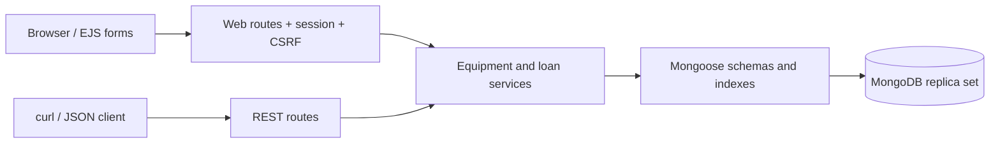
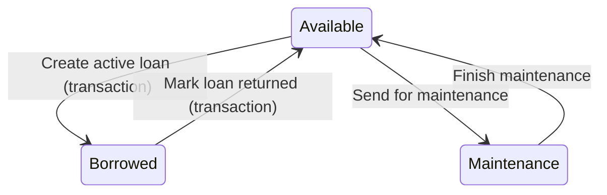

# Architecture and invariants

## Data model

- **User**: unique username, bcrypt password hash (not returned by normal queries), display name.
- **Equipment**: unique asset code, name, category, location, status, notes and timestamps. One record is one physical object.
- **Loan**: equipment reference, borrower name/ID, actual borrow time, optional due time, actual return time, status, optional handling staff reference and notes.
- Borrowers are loan metadata, not application login accounts. All seeded administrators have the same permissions.
- `Equipment.assetCode` has a unique index. Loan has a partial unique index on equipmentId where status is active. Compound indexes support category/status and borrower/status filtering.

## State transitions

The database stores lowercase enum values. There is no generic status-edit form or writable status in the equipment CRUD API. Maintenance cannot begin while an asset is borrowed.

## Why simultaneous requests are safe

Borrowing first conditionally changes an equipment document from available to borrowed inside a transaction, then inserts its loan in the same transaction. Competing writers contend on that document; retries see the new status and fail. The partial unique loan index provides another constraint. If insertion fails, the status change rolls back.

Returning updates an active loan and its borrowed equipment within one transaction. A repeated return fails, and an inconsistent asset causes both changes to roll back. Deletion checks availability/history and removes the asset in a transaction; concurrent checkout cannot leave a dangling loan.

## Security and scope

Web pages require a session. Login regenerates session IDs; logout destroys them. Passwords use bcrypt. Web writes require CSRF tokens. EJS output escapes stored text. Request bodies have a size limit and explicit field allow-lists; filter values are validated and regex search text is escaped. No user-controlled MongoDB operators are accepted.

The default unauthenticated REST mode meets the course specification but exposes modification operations to anyone who can reach the server. The local demo binds to loopback. For an Internet-facing deployment, enable API authentication, HTTPS and secure cookies as described in the deployment guide. `TRUST_PROXY=true` assumes exactly one trusted reverse proxy; do not enable it blindly on an exposed server.

The implementation intentionally omits pagination, individual borrower accounts, role-based staff permissions, reservation queues, damaged-on-return handling, email and inventory quantities. History is preserved by preventing deletion of previously loaned assets; permanent retirement/archive is a possible student extension.
